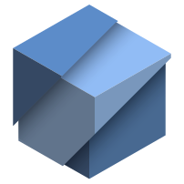

<div align="center">

  
  <h1>JO-Launcher</h1>

  <h2>Um launcher de desktop para Windows para Minecraft: Java Edition. O suporte a Linux está planejado.</h2>

  <p>
    <a href="https://jo-beacon.github.io/JO-Launcher/">Site oficial</a> ·
    <a href="https://github.com/JO-Beacon/JO-Launcher">GitHub</a> ·
    <a href="https://github.com/JO-Beacon/JO-Launcher/releases/latest">Versão mais recente</a>
  </p>

  <p>
    <a href="README.en.md">English</a> ·
    <a href="README.md">简体中文</a> ·
    <a href="README.zh-TW.md">繁體中文</a> ·
    <a href="README.ja.md">日本語</a> ·
    <a href="README.ko.md">한국어</a> ·
    <a href="README.de.md">Deutsch</a> ·
    <a href="README.es.md">Español</a> ·
    <a href="README.fr.md">Français</a> ·
    <b>Português</b> ·
    <a href="README.sv.md">Svenska</a>
  </p>

</div>

## Requisitos

- Windows 10 ou 11, 64 bits
- Um runtime Java para a versão do Minecraft que você quer iniciar (detectado automaticamente; pode ser definido por versão)
- Uma conta Microsoft que possua Minecraft: Java Edition
- Seu próprio ID de aplicativo (cliente) do Azure para entrar

## Recursos

- Inicia versões do Minecraft já instaladas
- Configurações por versão: runtime Java, limite de memória, argumentos da JVM
- Planejamento automático de memória com base na RAM instalada, substituível por versão
- Importa uma pasta ou zip de versão, renomeia e exclui versões
- Log de diagnóstico (Configurações → Logs) para solução de problemas
- Diretório de jogo por versão: saves, opções e mods ficam na pasta de cada versão, mantendo as versões isoladas
- Login da Microsoft pelo fluxo de código de dispositivo; informe seu próprio ID de aplicativo (cliente) do Azure em Configurações → Conta ou pelas variáveis de ambiente `JO_MS_CLIENT_ID` / `JOL_MS_CLIENT_ID`
- 10 idiomas de interface: English, 简体中文, 繁體中文, 日本語, 한국어, Deutsch, Español, Français, Português, Svenska
- Temas escuro, claro e seguir o sistema
- Usa uma pasta `.minecraft` portátil ao lado do executável; caso contrário, `%APPDATA%\.minecraft`

## Estrutura

```text
core/                 platform-independent C++20 core
  auth/               Microsoft / Xbox / Minecraft sign-in
  launch/             version manifests, Java detection, process launch
  mc/                 version scanning and per-version settings
  net/                HTTP transport
  platform/           OS backends: HTTP, key storage, process
platform/win32/       Win32 + Direct2D shell
assets/icon/          icon sources (SVG); the .ico is generated, not tracked
tools/                build helpers and binary checks
third_party/          bundled third-party sources
```

## Compilação (Windows)

Requer Visual Studio 2022 ou 2026 com a carga de trabalho C++ (ou as Build Tools correspondentes), CMake 3.25+ e Python 3 com Pillow. O ícone não é versionado: antes de compilar, execute `python tools/export-icons.py`, que gera cada tamanho a partir do SVG usando Edge ou Chrome sem interface.

Opcional (experimental): clone o [JO-DraftUI](https://github.com/JO-Beacon/JO-DraftUI) ao lado deste repositório e configure com `-DJO_USE_DRAFTUI=ON` para usá-lo; fica desativado por padrão e a compilação funciona sem ele. A interface ainda é desenhada com código Direct2D escrito à mão.

```powershell
python tools/export-icons.py
cmake -S . -B build/native -A x64
cmake --build build/native --config Release
```

Resultado:

```text
build/native/Release/JO-Launcher.exe
```

O executável é vinculado estaticamente ao runtime da MSVC.

## Status

A shell Win32 é a única interface implementada. Os backends Linux de HTTP, armazenamento de segredos e processos estão em `core/platform/`, mas a shell GTK ainda não foi iniciada.

## Licença

JO-Launcher é licenciado sob a Apache License 2.0; consulte [LICENSE](./LICENSE).
Os ícones (`assets/icon/`, `platform/win32/app.ico` e os do site) não são cobertos pela Apache License 2.0 e permanecem com todos os direitos reservados: podem acompanhar um JO-Launcher sem nenhuma modificação e idêntico à versão oficial, enquanto qualquer alteração — incluindo forks, mudança de nome ou de número de versão — exige substituí-los; consulte [assets/icon/LICENSE](./assets/icon/LICENSE).
Redistribuições devem incluir [NOTICE](./NOTICE) e manter os avisos de terceiros nele referenciados. Aviso de privacidade: [PRIVACY.md](./PRIVACY.md).

Não é um produto oficial do Minecraft. Não aprovado por Mojang ou Microsoft nem associado a eles. Minecraft, Mojang, Microsoft e Xbox são marcas da Microsoft Corporation ou de suas afiliadas.
