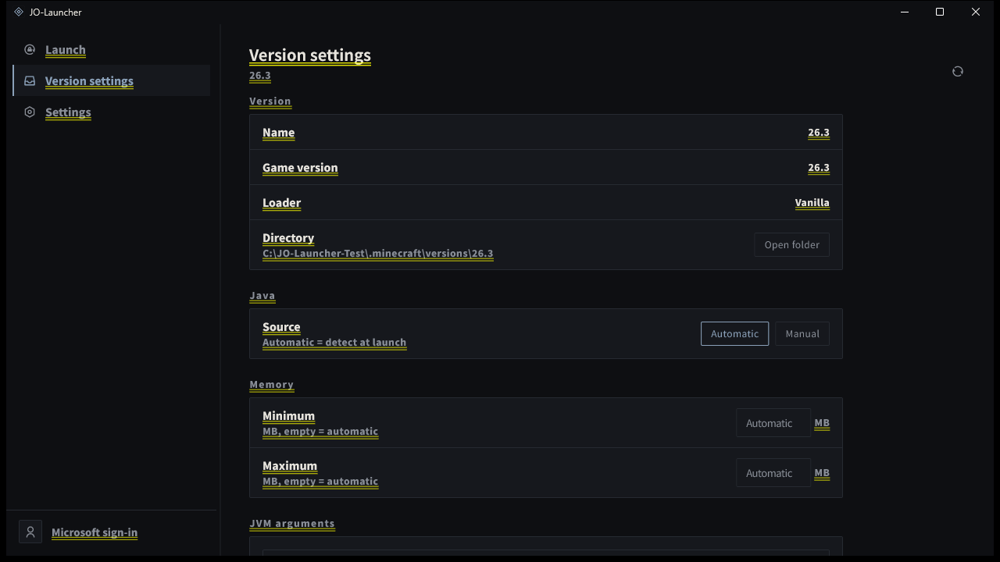

# JO-Launcher

[](https://github.com/JO-Beacon/JO-Launcher/actions/workflows/build-windows.yml)

JO-Launcher es un launcher de código abierto para Minecraft: Java Edition, centrado en iniciar instalaciones existentes con una experiencia de escritorio limpia y ágil. Windows es compatible hoy; el soporte para Linux está en la hoja de ruta.

[English](./README.md) · [日本語](./README_ja.md) · [Svenska](./README_sv.md) · [Português (Brasil)](./README_pt_BR.md) · [Español](./README_es.md) · [Français](./README_fr.md) · [Deutsch](./README_de.md) · [Website](https://jo-beacon.github.io/JO-Launcher/) · [Privacy](./PRIVACY.md) · [Apache License 2.0](./LICENSE)



> **NOT AN OFFICIAL MINECRAFT PRODUCT. NOT APPROVED BY OR ASSOCIATED WITH MOJANG OR MICROSOFT.**

## Características

- **Detección de versiones** — analiza `versions/` y reconoce instalaciones vanilla, Fabric, Quilt, Forge y NeoForge.
- **Ajustes de versión** — configura Java, límites de memoria y argumentos de la JVM por versión; los ajustes se guardan en `jolauncher.json` dentro del directorio de la versión.
- **Inicio de sesión de Microsoft** — inicia sesión con una cuenta Microsoft mediante el flujo de código de dispositivo.
- **Espacio de inicio** — elige una versión, inicia el juego, sigue el registro en vivo y detén el proceso.
- **Experiencia de escritorio** — temas oscuro / claro / seguir el sistema, barra lateral arrastrable y siete idiomas de interfaz.

## Hoja de ruta

- Gestión de versiones: instalar versiones del juego, importar modpacks, eliminar y cambiar de nombre
- Soporte de escritorio para Linux
- Avatares de cuenta y cambio entre cuentas
- Diagnóstico y recuperación de fallos

## Contribuciones

Las issues son bienvenidas. Los pull requests **no** se aceptan y se cerrarán automáticamente. Consulta [CONTRIBUTING.md](./CONTRIBUTING.md).

## Tecnologías

Flutter / Dart.

## Compilación

Necesitas el SDK de Flutter. En Windows, Inno Setup solo es necesario para generar el instalador.

El inicio de sesión de Microsoft requiere el client_id de una aplicación de Azure. **No se almacena en este repositorio**; pásalo en tiempo de compilación mediante una variable de entorno:

```powershell
$env:JO_MS_CLIENT_ID = "<your client_id>"
pwsh -ExecutionPolicy Bypass -File scripts\build.ps1
```

Para compilar la aplicación sin el instalador:

```powershell
flutter build windows --release --dart-define=JO_MS_CLIENT_ID=$env:JO_MS_CLIENT_ID
```

La aplicación se puede compilar sin `JO_MS_CLIENT_ID`; el inicio de sesión simplemente no estará disponible.

El soporte para Linux está planificado. El directorio de plataforma aún no se ha generado; las instrucciones de compilación se añadirán cuando exista `linux/`.

## Licencia

[Apache License 2.0](./LICENSE). Las redistribuciones deben incluir [NOTICE](./NOTICE); los avisos de licencias de terceros que contiene no pueden eliminarse.

## Componentes de terceros

- Flutter / Dart — BSD-3-Clause
- Noto Sans SC — SIL Open Font License 1.1
- Remix Icon — Remix Icon License v1.0

Las licencias del resto de dependencias Dart pueden verse en la pantalla de licencias de la aplicación.
