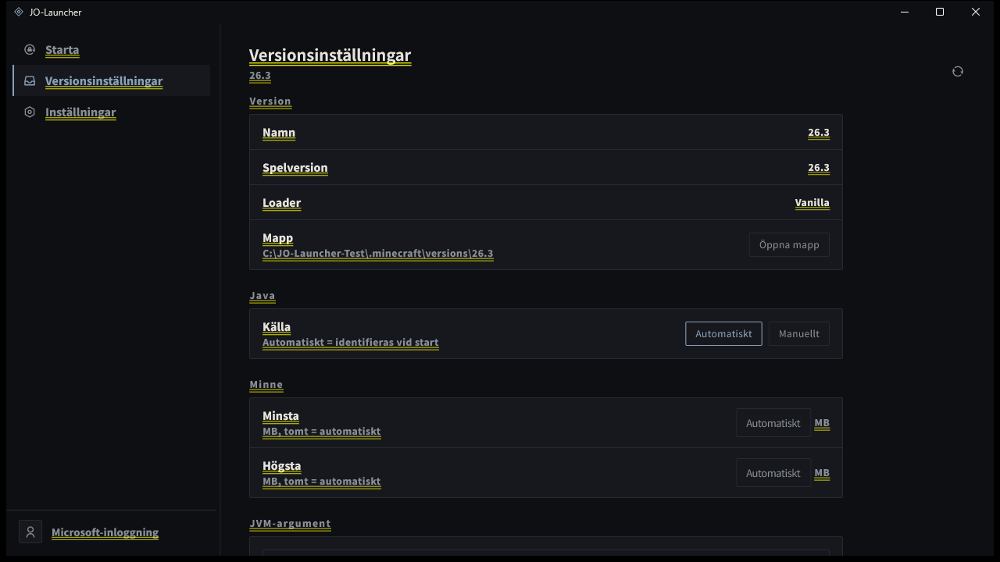

# JO-Launcher

[](https://github.com/JO-Beacon/JO-Launcher/actions/workflows/build-windows.yml)

JO-Launcher är en öppen källkods-startare för Minecraft: Java Edition, med fokus på att starta befintliga spelinstallationer med en ren och snabb skrivbordsupplevelse. Windows stöds idag; Linux-stöd finns på färdplanen.

[English](./README.md) · [日本語](./README_ja.md) · [Svenska](./README_sv.md) · [Português (Brasil)](./README_pt_BR.md) · [Español](./README_es.md) · [Français](./README_fr.md) · [Deutsch](./README_de.md) · [Website](https://jo-beacon.github.io/JO-Launcher/) · [Privacy](./PRIVACY.md) · [Apache License 2.0](./LICENSE)



> **INTE EN OFFICIELL MINECRAFT-PRODUKT. INTE GODKÄND AV ELLER ASSOCIERAD MED MOJANG ELLER MICROSOFT.**

## Funktioner

- **Versionsidentifiering** — skannar `versions/` och känner igen vanilla-, Fabric-, Quilt-, Forge- och NeoForge-installationer.
- **Versionsinställningar** — ställ in Java, minnesgränser och JVM-argument per version; inställningarna sparas i `jolauncher.json` i versionsmappen.
- **Microsoft-inloggning** — logga in med ett Microsoft-konto via enhetskodflödet.
- **Startarbetsyta** — välj en version, starta spelet, följ live-loggen och stoppa processen.
- **Skrivbordsupplevelse** — mörkt / ljust / följ systemet-tema, dragbar sidopanel och sju gränssnittsspråk.

## Färdplan

- Versionshantering: installera spelversioner, importera modpacks, radera och byta namn
- Linux-skrivbordsstöd
- Kontavatarer och kontoväxling
- Kraschdiagnostik och återställning

## Bidra

Issues är välkomna. Pull requests **accepteras inte** och stängs automatiskt. Se [CONTRIBUTING.md](./CONTRIBUTING.md) innan du öppnar en issue.

## Teknik

Flutter / Dart.

## Bygga

Du behöver Flutter SDK. På Windows behövs Inno Setup endast för att skapa installationsprogrammet.

Microsoft-inloggning kräver client_id för ett Azure-program. **Det sparas inte i det här repot**; skicka det vid byggtiden via en miljövariabel:

```powershell
$env:JO_MS_CLIENT_ID = "<your client_id>"
pwsh -ExecutionPolicy Bypass -File scripts\build.ps1
```

För att bygga appen utan installationsprogram:

```powershell
flutter build windows --release --dart-define=JO_MS_CLIENT_ID=$env:JO_MS_CLIENT_ID
```

Appen bygger även utan `JO_MS_CLIENT_ID`; inloggning är då helt enkelt otillgänglig.

Linux-stöd är planerat. Plattformsmappen har inte skapats än; bygginstruktioner läggs till när `linux/` finns.

## Licens

[Apache License 2.0](./LICENSE). Vid vidaredistribution måste [NOTICE](./NOTICE) inkluderas; tredjepartslicenserna i den får inte tas bort.

## Tredjepartskomponenter

- Flutter / Dart — BSD-3-Clause
- Noto Sans SC — SIL Open Font License 1.1
- Remix Icon — Remix Icon License v1.0

Licenserna för övriga Dart-beroenden finns i appens licensskärm.
